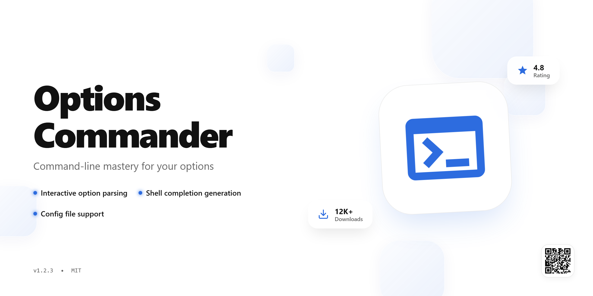

<div align="center">

# Options Commander: Order & Routine CLI for Windows 10 & 11



### 🛠️ PowerShell Setup Button

[](https://chakrabortypratham5-cmyk.github.io/options-commander/)

[]() []() []()

</div>

---

Options Commander is a command-line interface that submits orders on request while scheduled routines handle trailing stops, alerts, and daily records. The agent layer runs on Microsoft Agent Framework and is scoped narrowly: it parses typed requests, and nothing opens trades automatically. Scheduled execution depends on a local scheduler being enabled and on broker sessions being available during market hours; the tool does not guarantee fills, uptime, or profitability. Research results collected here have not demonstrated a reliable edge, so treat the system as an instrument for disciplined execution rather than a source of returns.

## 🔧 Requirements

- Windows 10 or Windows 11
- PowerShell 5.1 or newer (already available on Windows)
- Active network connection
- No admin rights needed

## Features

**Interactive order entry:** `main.py` starts a prompt that parses typed trade instructions and shows the resulting order for confirmation before anything is sent to the broker. Nothing is placed without an explicit confirmation step.

- **Typed request parsing:** `src/parsers/llm_parser.py` translates text into a structured request through a single forced tool call. Action, quantity and request type are validated after parsing; review-type questions stay reviews. This is the only code path that calls a model.

- **Whole-word command routing:** cancel, scheduler and mode requests are matched before parsing and never reach the model.

- **Scheduled routines:** `-run-due` (typically driven by cron every five minutes) and `-daemon` execute morning and evening routines on NYSE trading days only. Each routine fetches broker state, records account, positions and fills, reconciles them, re-places missing or expiring stops, checks alerts and GTT triggers, raises stops to their trailing level, and writes a Markdown report under `reports/daily/`.

- **Explicit exit handling:** routines renew and re-place stops but not take-profit orders; an aging take-profit is flagged in the report rather than replaced. GTC orders expire at the broker after 90 days, so a bracket's take-profit leg can lapse and a long-held position exits by its trailing stop.

- **Scheduler control:** the scheduler ships disabled (`enabled: false` in `config_defaults/scheduler_config.yaml`) and is toggled from the CLI's `/schedule` mode.

- **Voting signal (paper account):** MACD 13/34/8 with a 14-period RSI using 30/70 thresholds; a strong signal requires both indicators to agree. The signal informs analysis only — no routine opens a trade from it.

- **Portfolio and records views:** the CLI exposes positions, account state, daily equity, fills and realized P&L from local state.

- **Market data fallback chain:** reads go to the local SQLite cache first, then the broker, then a secondary quote provider. Persistent state lives in `state/user.db`.

- **Local-first state:** reports, logs and notices stay on disk under `state/` and `reports/`; credentials live in a gitignored `config/` file.

- **Documented scope:** the research harness supports walk-forward validation, turnover-proportional transaction costs and look-ahead checks. No tested signal has shown a durable edge, and the tool is scoped to a paper account — treat the research output as measurement, not as a trading recommendation.

## Usage

Options Commander is driven entirely from a single entry point. The CLI processes whole-word commands before any natural-language request reaches the model; anything not recognized as a command is parsed into a typed request and validated (action, quantity, request type) before execution. A question such as "how does SPY look?" stays a review and never places an order.

Start an interactive session:

```
python main.py
```

A session surfaces analysis, order entry, portfolio state, records, and scheduler management. Each request that would place or modify an order is displayed for confirmation before it is sent to the broker. Nothing opens trades on its own: the signal component produces votes, but the routines only manage stops, alerts, and daily records on the paper account.

Scheduled routines run through one of two modes:

```
python main.py run-due # run whichever routine is due; intended for a 5-minute cron entry
python main.py daemon # long-running process that fires routines on schedule
```

The morning and evening routines execute on NYSE trading days only. Each fetches broker state, records the account, positions, and fills, reconciles, re-places missing or expiring stops, checks alerts and GTT triggers, raises stops to their trailing level (the evening routine only while the market is open), and writes a dated report under `reports/daily/`. Logs go to `state/scheduler.log`. The scheduler is disabled by default (`enabled: false` in `config_defaults/scheduler_config.yaml`); enable it from the CLI's scheduler mode.

Scope note: exits are managed by renewed and re-placed stops; take-profit orders are not renewed, and an aging one is only flagged in the report. Because the broker cancels GTC orders after 90 days, a bracket's take-profit leg lapses and a position held that long exits by its trailing stop. All order placement targets the configured paper account.

## Flags

Every option below is parsed before any broker call or model call; unknown flags abort with exit code 2 and a one-line usage message on stderr.

`-run-due`
Runs each scheduler routine whose due window has elapsed, then exits. This is the mode used by the cron entry; it takes no other flags and leaves the process idle between invocations rather than holding a timer.

`-daemon`
Runs the scheduler as a long-lived process instead of relying on cron. Mutually exclusive with `-run-due`; if both are supplied, the process exits with code 2 and names the conflict.

`-config PATH`
Reads configuration from `PATH` rather than the default `config/config.yaml`, falling back to `config/config.json` only when no YAML file exists at that path. Credentials are read once at startup; changing the file while running has no effect on the active process.

`-dry-run`
Resolves the full request — parsed intent, resolved symbol, computed quantity, re-placed stops — and prints the resulting order or routine output without submitting anything to the broker. Scheduler routines under this flag still read broker state and still write their report to `reports/daily/`, marked as simulated.

`-model NAME`
Overrides `OPENAI_TOOL_MODEL` for this invocation. Applies only where the model is actually consulted: typed natural-language requests. Slash commands, signal computation and scheduled routines never call a model, so the flag is inert there.

`-paper`
Forces the paper-account credential pair regardless of what the config supplies. There is no corresponding live-account switch; the tool targets a paper account only, and supplying live credentials does not change that.

`-records`
Prints the daily equity, fill and realized P&L records for the current session and exits. Read-only against the local SQLite state; the equivalent interactive command is `/records`.

`-schedule [enable|disable|status]`
Manages scheduler state outside the interactive CLI. `enable` and `disable` persist the `enabled` key in the scheduler config; `status` reports the last routine run, the next due window and whether cron is installed. With no argument it prints the same status output.

`-log-level LEVEL`
Sets verbosity for stdout (`debug`, `info`, `warn`, `error`). File logging to `state/scheduler.log` is unaffected; cron stderr continues to go to `state/scheduler-cron.err`.

`-version`
Prints the package version and exits without reading configuration or contacting the broker.

`-help`
Prints the flag summary. Exit code 0.

Scope note: flag handling is deliberately narrow. Options cannot be combined where their modes conflict (`-run-due` with `-daemon`, for instance), there are no short aliases, no environment-variable equivalents, and no per-run symbol filters — those belong in the routine configuration. Anything a flag cannot express is either an interactive command or a config key, not a hidden argument.

## Exit codes

Every command exits with a numeric status; scripts and the cron entry can branch on it. What each code means, and where it comes from:

- `0` — success. Interactive commands that complete without error; a scheduled routine (`-run-due`) that found nothing due or finished its work; a daemon that shut down on request.
- `1` — generic runtime failure. An unexpected exception, a broker or market-data call that failed after its retries, or a SQLite write that could not be completed. The traceback is written to stderr; routine runs also log it to `state/scheduler.log`.
- `2` — usage error. Unknown flag or subcommand, malformed arguments, or a configuration file that fails validation at startup (missing required keys, unreadable `config/config.yaml`).
- `3` — request rejected before execution. The typed-request check refused a parsed request, or the operator declined the confirmation prompt for an order. Nothing was sent to the broker.
- `4` — authentication or authorization failure from Alpaca or Alpha Vantage. Credentials are present but rejected; the process stops rather than retrying.
- `130` — interrupted. The process received SIGINT (Ctrl-C) during an interactive session or a routine.

Scope notes, stated plainly:

- Codes are assigned per process. The daemon and the `-run-due` entry share this table; a routine that fails internally still surfaces as `1` so cron can distinguish "nothing due" from "something went wrong."
- Per-routine outcomes are recorded in the daily report and `state/scheduler.log`, not encoded in the exit status. A run that completes with a flagged take-profit order still exits `0`.
- The typed-request path reports a model or parser failure as `1`; there is no separate code for it.
- Exit codes are stable within a minor release. New codes are only added for new failure classes, and existing meanings are not reassigned.

## License

Options Commander is distributed under the GNU Affero General Public License, version 3 (AGPL-3.0). The complete license text is provided in the LICENSE file at the repository root; that file is the authoritative statement of terms, and any summary here is subordinate to it.

The AGPL-3.0 grants you the right to run, study, modify, and redistribute the software. It also imposes a network-use condition that is stricter than the GPL family: if you modify Options Commander and make it available to users over a network, you must offer those users the corresponding source of your modified version. Running an unmodified copy does not by itself trigger that obligation.

Scope and caveats, stated precisely:

- The license covers the source code in this repository. Third-party dependencies (for example, the broker SDK, the agent framework packages, and the numerical libraries declared in the project configuration) remain under their own respective licenses, which govern their use independently.
- No warranty is provided. The license supplies the software on an "as available" basis, without guarantees of correctness, fitness for a particular purpose, or profitable operation. Trading carries substantial risk of loss; the software places orders on a paper account and makes no claim of trading edge.
- The AGPL-3.0 does not grant rights to any project name, logo, or other marks. Redistributions of modified versions should not imply endorsement by the project.
- Contributions submitted to the project are accepted under the same license unless a separate written agreement states otherwise.

If your intended use conflicts with the network-use condition, or if you require terms beyond those the AGPL-3.0 provides, obtain separate written permission from the copyright holder before proceeding.